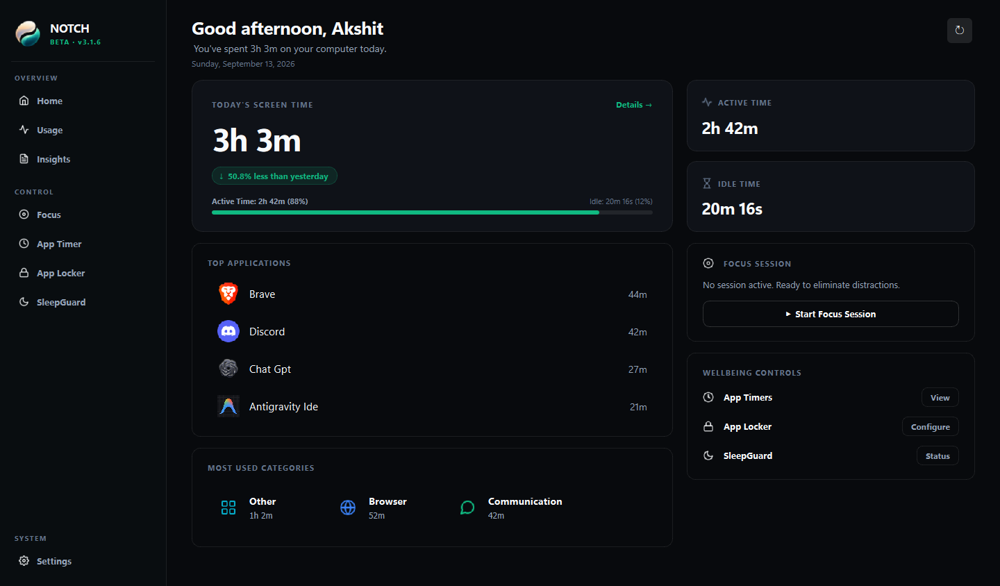
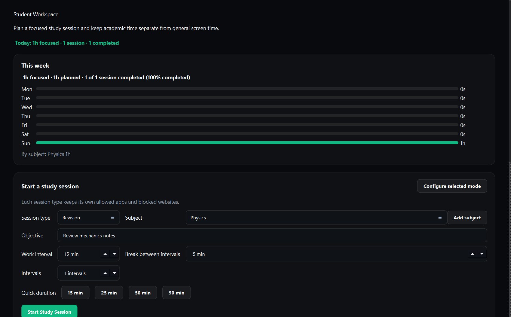

# Notch — Digital Wellbeing for Windows

Notch helps people understand their screen time, manage distractions, and make room for focused work. Student features are optional and use the same local Focus and timer systems as the rest of the application.

## What Notch does

- Tracks foreground application use, idle time, and daily activity history.
- Shows dashboard, usage, Insights, and weekly wellbeing reports with CSV or report export.
- Provides Focus profiles, deadline-based focus sessions, Deep Work intervals, website blocking, and recurring focus schedules.
- Supports App Timers, daily screen-time budgets, App Locker, and SleepGuard.
- Offers an optional Student Workspace with subject-tagged sessions, daily and weekly subject targets, recurring study blocks, assignment and exam reminders, exam topic progress, revision targets, and weekly study insights.
- Stores ordinary screen-time history separately from explicitly started study sessions.

## Screenshots





## Privacy and storage

Activity history, Focus sessions, and study plans are stored in a local SQLite database under the current Windows user profile. Notch does not upload those records or sync them to a cloud account. The SQLite file is not encrypted by Notch.

The desktop app sends a heartbeat containing a random installation ID and the app version; the heartbeat does not include activity records. When automatic update checks are enabled, Notch contacts GitHub to check for releases. The marketing website uses Vercel Analytics and Speed Insights for website visits; those measurements are separate from desktop activity data.

## Run from source

Requirements: Windows 10 or 11, Python 3.11 or newer, and the dependencies in `requirements.txt`.

```powershell
python -m venv .venv
.\.venv\Scripts\Activate.ps1
pip install -r requirements.txt
python main.py
```

Optional startup modes:

```powershell
python main.py --background
python main.py --service
```

## Tests

Run focused desktop regressions:

```powershell
pytest -q tests/test_focus_outline_cleanup.py tests/test_focus_timer_reliability.py tests/test_student_workspace.py
```

Run the full desktop suite:

```powershell
pytest tests
```

Run website checks from the `website/` directory:

```powershell
npm run lint
npm test
npx tsc --noEmit
npm run build
```

## Project layout

- `core/`, `database/`, `tracker/`, `protection/`, `analytics/`, `notifications/`, and `settings/` contain application services and data handling.
- `ui/` contains the PySide6 application shell, pages, shared widgets, and theme system.
- `tests/` contains automated desktop tests; interactive QA harnesses live under `tests/manual/`.
- `scripts/` contains capture, diagnostics, media, and packaging helpers.
- `website/` contains the independent Next.js marketing and distribution site.

See [AGENTS.md](AGENTS.md) for architecture and contribution boundaries.

## License

This project is licensed under the MIT License. See [LICENSE](LICENSE).
